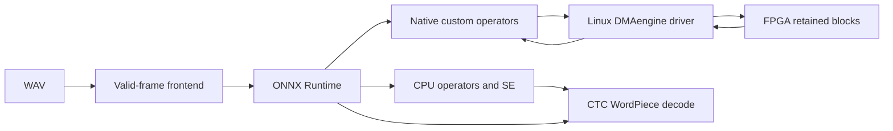

# Architecture

The host converts a mono 16 kHz waveform into 80-channel features using the pinned Citrinet frontend arithmetic. It emits valid frames only. The graph accepts at most 256 frames.

The selected graph has 24 physical transactions and 128 retained pair calls. Each inference transfers 256 sets of pointwise and depthwise weights. Those transfers remain inside the measured inference time. The first call also registers 24 packed programs with the driver.

The FPGA has 512 pointwise MACs and 64 depthwise lanes. It uses 128-bit AXI streams and retains intermediate activations across stages. Protocol 18 returns a residual projection and the final main-path result from one block. The native transport unpacks outputs with ARM NEON.

The CPU executes the remaining graph, including squeeze/excitation work and exact pooling and residual-tail operators. The same transformations apply to the CPU comparison graph. Graph/session creation happens before timed warm calls.

`software/mvp/runtime.py` compiles the selected graph from the model installed by the dependency setup script. It imports the graph transformations under `software/latency` and `software/ort_fpga_stream_branch512_neon`. It does not import historical benchmark scripts or private qualification reports. `config/assets.json` identifies original sources. `config/dependencies.json` identifies the external model, headers, drivers and prebuilt assets.

The prebuilt rollback image runs at 100 MHz with its own driver. The board runner checks that starting state, captures DMA IRQ masks, activates the branch image and restores the starting state afterward. A hardware failure propagates to the caller.
